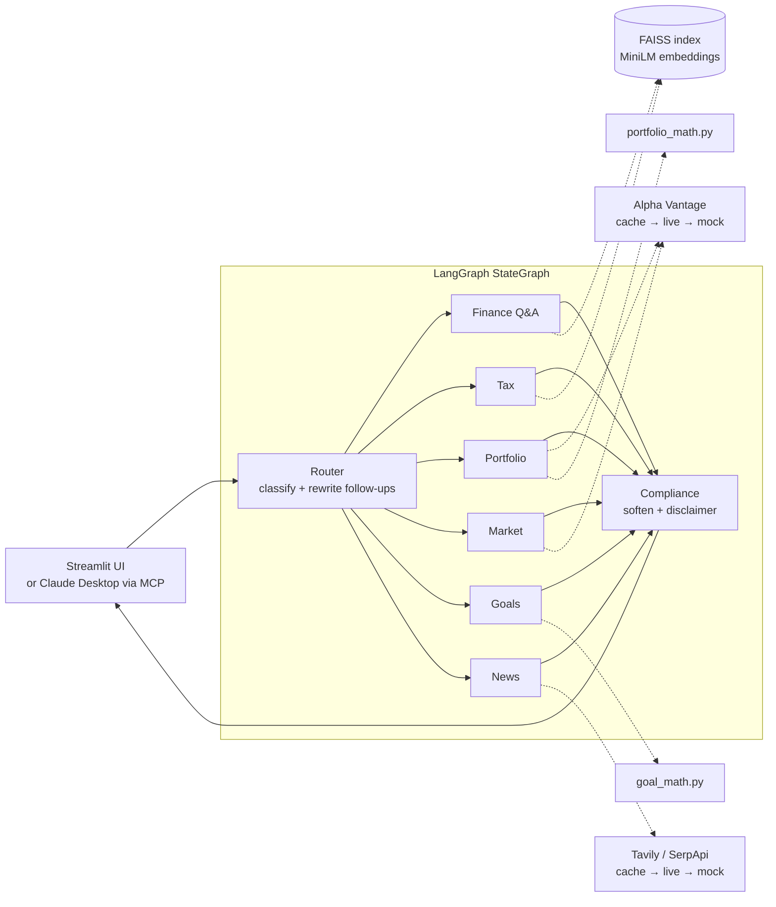

# Finnie — AI Finance Assistant

Finnie is a multi-agent tutor for people who want to start investing but are put off by
jargon. You ask a question in plain English; a LangGraph router hands it to one of six
specialist agents; the answer comes back grounded in a curated knowledge base, live market
data or a deterministic calculator, with sources.

> Finnie provides **financial education, not advice.** Every answer passes through a
> compliance step that softens advice-like wording and adds a disclaimer.

## What it does

| Agent | Answers questions like | Grounded in |
|-------|------------------------|-------------|
| **Finance Q&A** | "What is compound interest?" | RAG over `data/knowledge_base/` |
| **Tax Education** | "Roth IRA vs traditional IRA?" | RAG over `data/knowledge_base/` |
| **Portfolio Analysis** | "Is my portfolio diversified?" | Uploaded CSV, live prices, pandas risk metrics |
| **Market Analysis** | "How is Apple doing today?" | Alpha Vantage quotes (cached, mock fallback) |
| **Goal Planning** | "Save $50k in 5 years at 7%?" | Python savings calculator — the LLM only explains |
| **News Synthesizer** | "Latest news on interest rates" | Tavily / SerpApi, cited with links |

The Streamlit app has five tabs: **Chat**, **Portfolio** (allocation donuts, volatility,
max drawdown, growth-of-$100 chart), **Markets** (quotes, performance comparison, price
history), **Goals** (savings calculator with projection chart) and **Knowledge** (browse
and search the articles). Finnie's tools are also available in **Claude Desktop** through
an MCP server.

## Architecture



Each user turn runs **router → one specialist → compliance**:

1. **Router** (`src/agents/router.py`) reads the last few messages of the conversation,
   picks a route with structured LLM output, and rewrites a follow-up into a standalone
   question ("what about the limits?" → "What are the Roth IRA contribution limits?").
   If the LLM is unavailable it falls back to keyword rules.
2. **Specialist** calls its tools and drafts an answer from their output only.
3. **Compliance** replaces advice-like phrases ("you should buy" → "some investors choose
   to"), appends the disclaimer, and adds the answer to the conversation history.

Role-by-role details, the shared state contract and coding standards are in
[`agent.md`](agent.md).

## Design decisions

- **Conversation memory.** The graph is compiled with a LangGraph checkpointer; each chat
  session (and each MCP `conversation_id`) is its own thread, so follow-up questions keep
  their context. The Chat tab shows how a follow-up was understood, and **New
  conversation** starts a fresh thread.
- **Numbers come from Python, not the LLM.** Savings plans, portfolio weights, HHI,
  volatility and drawdown are computed in `src/tools/`; the LLM is told to quote them, and
  tests check that it does.
- **RAG says when it doesn't know.** Chunks scoring below `RAG_MIN_SCORE` (0.45 cosine)
  are discarded — on-topic matches measured ≥ 0.5, off-topic ≤ 0.43. With no match left,
  the answer is labelled *"I don't have an article on this…"* and carries no citations,
  instead of citing an unrelated article.
- **The demo can't run out of quota.** Alpha Vantage's free tier allows 25 requests a
  day, so every external call goes through a disk cache (quotes 30 min, daily history
  12 h), is throttled to 1 request/second, and falls back to sample data on any failure.
  The UI marks sample data as such.
- **Failures never reach the user as tracebacks.** Each specialist is wrapped so a crash
  becomes a friendly message, and the error is kept in state for tests and logs.
- **Portfolio "recommendations" are educational.** Each warning flag (single holding over
  25%, fewer than 5 holdings, one asset class, high volatility) comes with a *thing to
  learn about*, never a buy/sell instruction.
- **Async throughout.** Agent nodes are `async`; blocking HTTP runs in threads; Streamlit
  calls the graph through one long-lived event loop (`src/aio.py`) so the cached OpenAI
  client keeps working across turns.

## Setup

Requires **Python 3.12**.

```bash
python3.12 -m venv venv && source venv/bin/activate
pip install -r requirements.txt
cp .env.example .env          # then add your API keys
python -m src.rag.ingest      # build the FAISS index
streamlit run src/ui/app.py
```

| Key in `.env` | Needed for | Without it |
|---------------|------------|------------|
| `OPENAI_API_KEY` | All agents | Required |
| `ALPHA_VANTAGE_API_KEY` | Live quotes and price history | Sample data |
| `TAVILY_API_KEY` or `SERPAPI_API_KEY` | Live news | Sample headlines |

Set `USE_MOCK_DATA=true` to run entirely on sample market and news data.

### Example questions

- What is compound interest? → then *"Can you give me an example with $1,000?"*
- What's the difference between a Roth IRA and a traditional IRA? → then *"What are the limits?"*
- How are SPY and QQQ doing today?
- How much should I save monthly to reach $20,000 in 4 years?
- (after loading the sample portfolio) Is my portfolio diversified?
- What happened in the stock market this week?

## Claude Desktop (MCP server)

`src/mcp_server.py` exposes Finnie over MCP (stdio):

| Tool | What it returns |
|------|-----------------|
| `ask_finnie` | A full answer from the multi-agent graph; pass `conversation_id` to keep context |
| `get_stock_quote` | Latest quote plus 100-day return, volatility and max drawdown |
| `analyze_portfolio` | Weights, HHI, asset mix, risk metrics, flags and considerations |
| `plan_savings_goal` | Monthly saving needed for a target |
| `search_knowledge_base` | Matching knowledge-base passages with relevance scores |
| `get_financial_news` | Recent headlines with links |

Add this to Claude Desktop's config (*Settings → Developer → Edit Config*), using absolute
paths to your checkout, then restart Claude Desktop:

```json
{
  "mcpServers": {
    "finnie": {
      "command": "/absolute/path/to/finnie-project/venv/bin/python",
      "args": ["/absolute/path/to/finnie-project/src/mcp_server.py"]
    }
  }
}
```

The server reads the same `.env` as the app. To try it without Claude Desktop:
`npx @modelcontextprotocol/inspector venv/bin/python src/mcp_server.py`.

## Knowledge base

`data/knowledge_base/` holds 34 Markdown articles, each with a `Source:` line:

- **30 public-domain pages** from IRS.gov and consumerfinance.gov (CFPB) on retirement
  accounts, taxes, credit basics and scams, collected by `scripts/scrape_kb.py`. The
  scraper uses a fixed list of URLs, honours robots.txt, waits 3 s between requests and
  strips site navigation. Investor.gov and Bogleheads block automated access and FINRA's
  terms forbid scraping, so they are not scraped.
- **4 hand-written articles** on core concepts (compound interest, diversification,
  ETFs vs mutual funds, 401(k) vs IRA vs Roth).

After adding or editing articles, rebuild the index with `python -m src.rag.ingest`.

## Tests

```bash
pytest              # 70 offline tests: no API keys, ~6 s
pytest -m live -s   # 15 live tests against OpenAI / Alpha Vantage / Tavily
ruff check .
```

The offline suite replaces the LLM with a deterministic fake and forces sample data. It
covers every route end to end; conversation memory (follow-ups, thread isolation, first
questions kept verbatim); unsourced-answer labelling; LLM and agent failure fallbacks;
portfolio edge cases (empty or malformed CSVs, negative or missing shares, duplicate
tickers, unpriced holdings, zero value, missing history); risk-metric math; live → mock
fallbacks for market data; every MCP tool; and Streamlit rendering of each tab.

The live suite prints each question, route and answer for human review, and checks
routing, citations, follow-up rewriting, that computed numbers are quoted, and that no
advice phrasing gets through. One run uses about 25 `gpt-4o-mini` calls and up to 7
Alpha Vantage requests.

## Project layout

```
src/
  config.py      settings from .env (the only place env vars are read)
  llm.py         chat-model factory
  state.py       FinnieState shared by all nodes
  graph.py       LangGraph wiring + checkpointer, run_query()
  aio.py         one long-lived event loop for sync callers
  mcp_server.py  MCP server for Claude Desktop
  agents/        router, six specialists, compliance, shared helpers (base.py)
  tools/         market_data, news_search, portfolio_math, goal_math, cache
  rag/           ingest (build index), retriever (search + relevance filter)
  ui/            app.py + tabs/ (chat, portfolio, markets, goals, knowledge)
data/
  knowledge_base/       articles that ground RAG answers
  mock/                 sample quotes and news for offline runs
  sample_portfolio.csv
scripts/scrape_kb.py    knowledge-base scraper
tests/                  offline + live suites
```

## Limitations

- Conversation memory lives in process memory: restarting the app clears it.
- Price history covers the last 100 trading days (Alpha Vantage free tier), so volatility
  and drawdown describe a short window.
- Market data is US-only, and the 25 requests/day limit means a busy demo may switch to
  sample data; the UI says when it does.
- Answers are for learning. They are not personalized financial, investment or tax
  advice.
